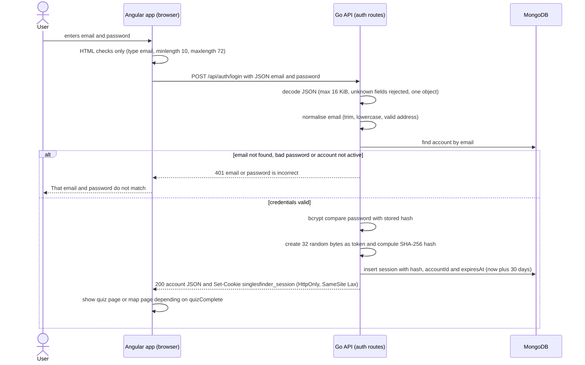
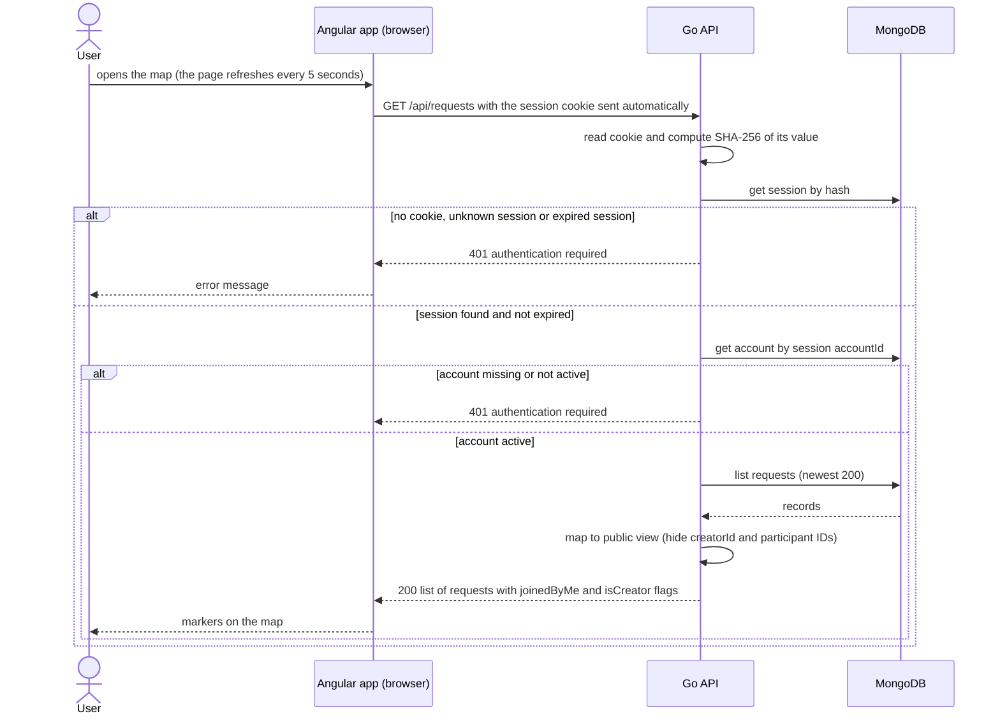
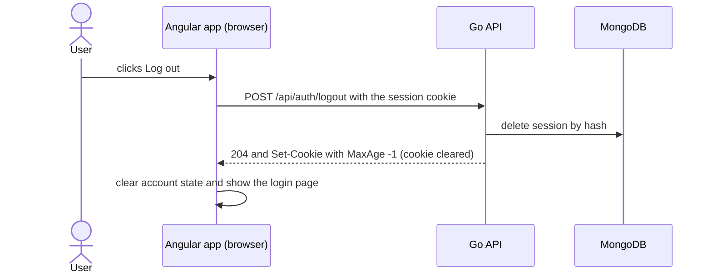
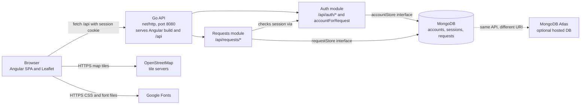

# Authentication Report — Singles Finder ("Closer")

| | |
|---|---|
| **Repository** | https://github.com/Yado3312/Singles_Finder |
| **Commit analysed** | `f31aa1b` (branch `main`, 2026-11-03) |
| **Stack** | Angular 20 (SPA) + Leaflet, Go API (`net/http`), MongoDB (driver v2.9.2), Docker Compose |
| **Report date** | 2026-11-04 |
| **Authors** | `MAURO RIVERO / RENE TREJO / YADIER GONZALEZ / JOHAN BERTRAND / LIAM AGUILAR / GERARDO TERRAZAS` |

## Summary

Singles Finder implements **its own server-side session authentication**. A user registers or logs in with email and password; the Go API verifies the password against a **bcrypt** hash, creates a random **opaque session token**, stores only the token's **SHA-256 hash** in MongoDB, and sends the raw token to the browser in an **`HttpOnly`, `SameSite=Lax` cookie**. Every protected endpoint resolves the cookie to a session and then to an active account on the server. There is **no JWT, no OAuth 2.0 and no third-party identity provider**.

Unlike a token-in-`localStorage` design, the browser never exposes the credential to JavaScript, and logout really invalidates the session because the server can delete it.

**How this maps to the "microservice" wording of the assignment.** The authentication logic is not a separately deployed service: it lives in the same Go process (and the same container) that serves the Angular build and the map-request API. It is, however, a clearly separated module: all `/api/auth/*` routes are registered by `registerAuthRoutes`, and all persistence goes through the `accountStore` interface (`backend/auth.go`), which has a MongoDB implementation and an in-memory test double. `[CONFIRM: tell your teacher whether your team presents the Go API as "the auth microservice", or as a monolith with an auth module]`

Where this report says something is a limitation, it is labelled **Gap**. Everything is based on reading the code at the commit above; section 7 states exactly what was executed and what was not.

Key findings, most important first:

1. **Cookie `Secure` flag depends on `r.TLS`** (`auth.go` lines 144 and 151). Behind any HTTPS reverse proxy that terminates TLS (the normal production setup), Go sees plain HTTP and the cookie is issued **without** `Secure`.
2. **No rate limiting or lockout** on login or register (acknowledged in the README), so online password guessing is unrestricted.
3. **No security headers** (no CSP, HSTS, `X-Frame-Options`, `X-Content-Type-Options`) and **no logging of login events**.
4. **Sessions last a fixed 30 days** with no renewal, no rotation at login, and no "log out everywhere".
5. **Small behaviours that leak or confuse:** registration reveals whether an email exists (`409`); an expired session during map polling shows the message "That email and password do not match."; logout fails (and the cookie stays) if the database is down.

---

## 1. Mechanism

**What is used:** *server-side sessions* with an opaque random token carried in a cookie, plus *bcrypt* password hashing. Own implementation; no third party involved in authentication.

| Aspect | Implementation | Source |
|---|---|---|
| Password storage | `bcrypt.GenerateFromPassword(..., bcrypt.DefaultCost)`; password length 10–72 characters (72 is bcrypt's input limit) | `auth.go` lines 199, 203 |
| Credential check | `FindByEmail` then `bcrypt.CompareHashAndPassword`, and `account.Status == "active"` | `auth.go` lines 241–253 |
| Session token | 32 bytes from `crypto/rand`, hex-encoded (256 bits of entropy) | `newSessionToken`, `auth.go` line 107 |
| Session storage | MongoDB collection `sessions`: `_id` = SHA-256 of the token, `accountId`, `expiresAt` | `models.go` line 22 |
| Transport | Cookie `singlesfinder_session`, `HttpOnly`, `SameSite=Lax`, `Path=/`, `Secure` only if `r.TLS != nil` | `setSessionCookie`, `auth.go` line 140 |
| Frontend | `fetch(..., { credentials: 'same-origin' })`; no `localStorage` / `sessionStorage` use anywhere in `src/` (searched) | `map-api.service.ts` line 44 |
| OAuth 2.0 / JWT / third-party login | Not used | — |

**Why sessions instead of JWT.** `[CONFIRM: adjust to your team's reasoning]` The design follows from the project's shape: a single backend and a single origin (the Go process serves both the SPA and `/api`), so there is no need for stateless tokens to be verified by several services. Server-side sessions let the server **revoke access immediately** (logout deletes the session; a suspended account is rejected on the next request) and keep the credential out of reach of JavaScript. The `docs/data-model.md` describes this intent: *"Server-side session; the raw random token is only sent in an `HttpOnly`, `SameSite=Lax` cookie."*

**Why an own implementation instead of a third party.** `[CONFIRM: adjust]` It keeps the course project self-contained (no external accounts, keys or quotas), runs fully offline in Docker, and lets the team show every step of authentication. The cost is that every security feature must be built and maintained by the team.

**Sessions vs JWT**

| | Server-side session (this project) | JWT (stateless) |
|---|---|---|
| **Pros** | Instant revocation; token carries no data; nothing readable if the cookie leaks beyond a random string; easy logout | No database lookup per request; convenient across several services or domains |
| **Cons** | One or two database reads on every request (`GetSession` + `GetAccount`); needs shared state if the API is scaled out (here the state is in MongoDB, so scaling is fine) | Hard to revoke before expiry; claims are readable by anyone; larger attack surface if signing keys leak |

**Own vs third-party authentication**

| | Own (this project) | Third-party (Auth0, Firebase, Sign in with Google) |
|---|---|---|
| **Pros** | Full control and visibility; no vendor lock-in or cost; works offline; user data stays in the team's database | Mature password handling, MFA, brute-force protection, email verification and recovery out of the box; far less security code to maintain |
| **Cons** | Missing features must be built by hand — here: rate limiting, email verification, password recovery, MFA, audit logging; mistakes are easy to make | Vendor dependency and possible cost; provider outage blocks login; user identities live outside your infrastructure |
| **Fit here** | Appropriate for a course project and a first release | Recommended before real users: this is a dating-style app handling sensitive personal data, and the README itself says it is not ready for production |

**Third parties that do exist in the system (none authenticate users)**

| Third party | Used for | Where |
|---|---|---|
| OpenStreetMap tile servers | Map images | `src/main.ts` line 205 |
| Google Fonts (`fonts.googleapis.com`, `fonts.gstatic.com`) | Typography | `src/index.html` |
| MongoDB Atlas (optional) | Hosted database when `compose.atlas.yaml` is used | `README.md`, `.env.example` |

---

## 2. Flow

### 2.1 Login



Registration (`POST /api/auth/register`) follows the same last steps: it additionally validates the name (2–80 characters), the birth date (age 18–120), hashes the password with bcrypt, inserts the account (unique index on `email`, duplicate returns `409`) and immediately issues a session.

The browser-side checks are a convenience only: anyone can call the API directly, so all validation is repeated on the server (`auth.go` lines 196–202, 236–240).

### 2.2 Protected request (`GET /api/requests`)



The same check (`accountForRequest`, `auth.go` line 155) guards `POST /api/requests`, `POST /api/requests/{id}/join`, `GET /api/auth/me`, `PUT /api/auth/quiz` and `PUT /api/auth/settings`. When the page loads, the frontend calls `GET /api/auth/me` once (`restoreSession`, `main.ts` line 60) to decide between the login page and the app.

### 2.3 Logout



---

## 3. Token / session

The token is **opaque**, so it has no claims. The identity information lives on the server, in the session document.

| Property | Value |
|---|---|
| Format | 64 hexadecimal characters (32 random bytes). Not a JWT; contains no data |
| Equivalent of claims (server side) | `_id` = SHA-256 of the token · `accountId` · `expiresAt`. The account's `status` is re-checked on every request |
| Signature / integrity | Not needed: an unguessable random value is looked up in the database. Only its hash is stored, so a database leak does not yield usable cookies |
| Cookie attributes | `HttpOnly` · `SameSite=Lax` · `Path=/` · `Secure` only when Go itself terminates TLS · `Expires`/`MaxAge` = 30 days |
| Expiry | **Absolute 30 days** from creation (`sessionDuration`). Checked in code on every request, and a MongoDB TTL index on `sessions.expiresAt` (`expireAfterSeconds: 0`) deletes old records (TTL cleanup is eventual, typically within about a minute, which is why the code check exists) |
| Renewal | **None.** There is no refresh endpoint and no sliding expiry; after 30 days the user must log in again |
| Logout | `POST /api/auth/logout` deletes the session document and clears the cookie (`204`). A test asserts that `/api/auth/me` returns `401` afterwards (see section 7) |
| Immediate revocation | Setting `accounts.status` to anything other than `active` invalidates all that account's sessions on their next request. Nothing in the code sets that status yet |

**Gaps and recommendations**

| Gap | Recommendation |
|---|---|
| Logging in does not invalidate older sessions of the same account; unlimited concurrent sessions | Cap sessions per account; offer "log out of all devices" (delete by `accountId`, which already has an index) |
| No session rotation at login or after sensitive changes | Issue a new token at privilege changes; delete the previous one |
| 30-day fixed lifetime | Shorter lifetime (for example 7 days) with sliding renewal and an absolute maximum |
| Cookie name is not `__Host-` prefixed | Use `__Host-singlesfinder_session` (requires `Secure`, `Path=/`, no `Domain`) |
| `Secure` depends on `r.TLS` | Set `Secure` always in production, or derive it from a trusted `X-Forwarded-Proto` behind a known proxy |
| No password change or reset endpoint | Add them together with revocation of all sessions |

---

## 4. Architecture



How it is deployed (`compose.yaml`, `Dockerfile`): two containers. The `app` container is a multi-stage build (Node builds Angular, Go builds a static binary, runtime image is Alpine running as non-root user `10001`) and publishes **`127.0.0.1:8080` only**. The `mongo` container (MongoDB 8.0) publishes **no ports**; it is reachable only from the Compose network. In development, `ng serve` on port 4200 proxies `/api` to `127.0.0.1:8080` (`proxy.conf.json`), keeping a single origin.

**Data and endpoints between each pair**

| From → To | Endpoint / protocol | Data |
|---|---|---|
| Browser → Go API | `POST /api/auth/register` | Request `{name, email, password, birthDate}` · Response `200` account view + `Set-Cookie` · `400` invalid · `409` email taken |
| Browser → Go API | `POST /api/auth/login` | Request `{email, password}` · Response `200` account view + `Set-Cookie` · `401` invalid credentials |
| Browser → Go API | `GET /api/auth/me` | Cookie → `200` account view · `401` |
| Browser → Go API | `POST /api/auth/logout` | Cookie → `204` + cleared cookie |
| Browser → Go API | `PUT /api/auth/quiz` | Cookie + `{interests, personality, datePace}` → `200` account view · `400` |
| Browser → Go API | `PUT /api/auth/settings` | Cookie + `{name}` → `200` account view · `400` |
| Browser → Go API | `GET /api/requests` · `POST /api/requests` · `POST /api/requests/{id}/join` | Cookie (required). Create needs `quizComplete`; coordinates rounded to 3 decimals (about 100 m). Responses expose creator name and interests, never creator or participant IDs |
| Browser → Go API | `GET /api/health` | No auth. `200 {"status":"ok"}` or `503` if MongoDB does not answer a ping within 3 s |
| Go API → MongoDB | MongoDB wire protocol (`mongodb://mongo:27017` or an Atlas `mongodb+srv://` URI) | Collections `accounts` (unique `email` index), `sessions` (TTL on `expiresAt`), `requests`. The account document is never returned as is: handlers return `accountResponse` without `passwordHash` or birth date |
| Browser → OpenStreetMap | HTTPS tile requests | Map tile coordinates (reveals approximate viewed area and IP to OSM) |
| Browser → Google Fonts | HTTPS CSS and font files | The user's IP and user agent are sent to Google |
| Go API → third-party identity provider | **None** | — |

---

## 5. Failure

| Failure | What happens | Verified how |
|---|---|---|
| **Go API / auth module down** | The Angular app is served by the same process, so the whole site is down. If only the API is unreachable (for example a proxy problem), the page loads, `restoreSession` falls into its `catch`, and the user sees the login form with *"Could not reach the server. Make sure the API and database are running."* Nobody can log in; no data is returned (fails closed). Compose restarts nothing by default (no `restart:` policy is set) | Code reading (`main.ts` lines 60–71) |
| **MongoDB down at start-up** | `connectMongo` pings with a 15-second context; on failure `main` calls `log.Fatal` and the process exits, so the container stops. Compose waits for Mongo's health check before starting the app, which avoids this normally | Code reading (`main.go` lines 46–51, `compose.yaml`) |
| **MongoDB goes down while running** | Every authenticated call (`accountForRequest`) fails to read the session; the error is not `errInvalidSession`, so it falls to the default branch: it is logged and the client gets `500 account service unavailable`. **No request is ever treated as authenticated when the database cannot confirm the session** (fail closed). Server selection times out after 5 s, so calls take up to about 5 s to fail. `/api/health` returns `503` | Code reading; `TestHealthReportsDatabaseFailure` covers the health endpoint |
| **Logout while MongoDB is down** | `DeleteSession` fails, the handler returns `500` **before** clearing the cookie, so the cookie stays and the UI shows *"We could not sign you out"*. The session remains valid until the database returns. **Gap**: clear the cookie anyway and retry the deletion | Code reading (`auth.go` lines 270–283, `main.ts` line 177) |
| **MongoDB Atlas down / IP not allowed** | Same as any database outage; Atlas needs the host's IP in its allow list | README |
| **OpenStreetMap tiles down** | Authentication and data still work; the map shows markers over an empty or grey background | Code reading (tiles are loaded by the browser only) |
| **Google Fonts down or blocked** | Login is unaffected; text uses fallback fonts (`display=swap` in the URL). Note that the production Angular build fetches the font CSS at build time (see section 7) | Code reading; build observation |
| **Session expires while the user is in the app** | The 5-second map refresh receives `401` and `errorMessage` maps every `401` to *"That email and password do not match."* The user is **not** sent back to the login page. **Gap**: on `401` from a non-login call, reset the app state and show the login form | Code reading (`main.ts` lines 259–260, 381) |

---

## 6. Security

### Measures applied

- **Passwords:** bcrypt; length 10–72; never returned by the API (a test asserts the register response contains no `passwordHash`).
- **Session tokens:** 256-bit `crypto/rand`; only the SHA-256 hash is stored; `HttpOnly` cookie; `SameSite=Lax`; server-side expiry and deletion at logout.
- **Generic login error:** unknown email, wrong password and inactive account all return the same `401` message.
- **Input handling:** JSON body capped at 16 KiB, unknown fields rejected, exactly one JSON object; email normalised and validated; birth date age gate (18–120); quiz answers checked against an allow-list; coordinates validated and rounded.
- **Authorization:** the account always comes from the session, never from client-supplied IDs; join is blocked for your own request or a repeat join; responses hide `creatorId` and participant IDs.
- **No NoSQL injection path:** queries are built with typed Go values (`bson.D`) and the email is a plain string.
- **No XSS sink found:** no `innerHTML` or `bypassSecurityTrust*` in `src/`; the only HTML given to Leaflet (marker tooltip) is escaped for `& " < > '`.
- **API responses** carry `Cache-Control: no-store`.
- **Same-origin design:** no CORS headers, so other sites cannot read API responses with cookies.
- **Deployment:** multi-stage Docker build, non-root user, app published on `127.0.0.1` only, database not published, `.env` excluded from Git and from the Docker context.
- **Secrets hygiene:** no real credentials in the repository or its 5-commit history (scanned; see section 7).
- **Dependencies:** `npm audit --omit=dev` reports 0 vulnerabilities.

### OWASP Top 10:2025 mapping

| ID | Category | Observation in this project | Risk | Recommended fix |
|---|---|---|---|---|
| **A01:2025** | Broken Access Control | Every data endpoint requires a valid session and uses the session's account ID; the response hides internal IDs. All authenticated users can see all requests with a rounded location (about 100 m). Nothing in the code changes `status`, so suspension is untested | Low | Keep the pattern; add object-level checks when messaging, likes and blocks are built (the data model already plans them); add a test for a suspended account |
| **A02:2025** | Security Misconfiguration | **No security headers** (CSP, HSTS, `X-Frame-Options`, `X-Content-Type-Options`, `Referrer-Policy`). **Cookie `Secure` depends on `r.TLS`**, so behind a TLS-terminating proxy it is missing. The Compose MongoDB runs **without authentication** (reachable only on the internal network). Server sets only `ReadHeaderTimeout` (no read, write or idle timeouts). The Atlas cluster hostname is in `.env.example` (not a secret, but protect it with credentials and the IP allow list) | **Medium–High** | Add a headers middleware (CSP allowing OSM tiles and Google Fonts, or self-host fonts); set `Secure` explicitly in production; enable MongoDB auth in Compose; set `ReadTimeout`, `WriteTimeout`, `IdleTimeout` |
| **A03:2025** | Software Supply Chain Failures | Small dependency set; lockfiles present (`package-lock.json`, `go.sum`); `npm audit --omit=dev` = 0 vulnerabilities. Go dependencies were **not** audited (see section 7). Docker base images are pinned by tag, not digest. Runtime third parties (OSM, Google Fonts) are contacted by every visitor's browser; Google Fonts is also fetched during the production build | Low–Medium | Run `govulncheck ./...` and add it to CI; pin images by digest; enable Dependabot; self-host the fonts (also improves privacy) |
| **A04:2025** | Cryptographic Failures | Good: bcrypt, 256-bit random tokens, hashed token storage. **Cookie can travel over HTTP** when `Secure` is missing; the stack ships no TLS. Atlas connections use TLS (`mongodb+srv`); the local Compose MongoDB link is plain inside the Docker network | **Medium** | Terminate TLS in front of the app and force `Secure` + HSTS; consider a bcrypt cost above the default (10) and revisit it periodically |
| **A05:2025** | Injection | Typed structs and `bson.D` queries; `DisallowUnknownFields`; escaped tooltips; no `innerHTML`. Reasonably covered | Low | Add fuzz or negative tests for odd JSON types and long strings |
| **A06:2025** | Insecure Design | The README states what is missing: email verification, password recovery, rate limits, moderation. No threat model; sensitive data (birth date, interests, approximate locations) for a dating-style app. Sessions are fixed-length with no rotation or revoke-all | **Medium** | Write a short threat model; plan email verification and password reset before real users; add session management features (section 3) |
| **A07:2025** | Authentication Failures | **No rate limiting or lockout** on login or register; no MFA; no password-strength check beyond length 10–72; no breached-password check; **registration reveals existing emails (`409`)**; login for an unknown email returns before running bcrypt, so response time probably differs (not measured); older sessions are not invalidated at login | **High** | Per-IP and per-account rate limit with backoff; uniform response behaviour (run a dummy bcrypt for unknown emails); generic registration response plus email confirmation; optional MFA for sensitive features |
| **A08:2025** | Software or Data Integrity Failures | Session integrity is enforced by lookup of an unguessable token; no unsigned data is trusted from the client. No CSRF token or `Origin` check: protection relies on `SameSite=Lax` (cross-site `POST`/`PUT` do not carry the cookie) and on same-origin design. No CI pipeline or signed images in the repo | Low–Medium | Add an `Origin`/`Sec-Fetch-Site` check on state-changing requests and require `Content-Type: application/json` (not enforced today); add CI with tests and `govulncheck` |
| **A09:2025** | Security Logging & Alerting Failures | Only unexpected errors are logged (`account operation failed`, request errors). **No record of successful or failed logins, registrations, logouts or session rejections**; no alerting | **Medium** | Structured audit log (time, event, account ID or email hash, IP) — never the password or token; alert on bursts of failed logins |
| **A10:2025** | Mishandling of Exceptional Conditions | Mostly good: database errors are logged and returned as a generic `500`, and the system fails closed. Gaps: **logout fails and keeps the cookie when the database is down**; **expired-session `401` is shown as a wrong-password message** and the user is not returned to login; the first Mongo error at start-up terminates the process | Low–Medium | Always clear the cookie at logout; central `401` handling in `MapApiService`; add `restart: unless-stopped` and a retry loop at start-up |

### Remaining risks (priority order)

1. Missing `Secure` flag behind a TLS-terminating proxy, and no TLS in the shipped stack (A02, A04).
2. Unlimited login and registration attempts, and email enumeration (A07).
3. No security headers and no audit logging (A02, A09).
4. Fixed 30-day sessions without rotation, revoke-all, or password reset (A06, A07).
5. Go dependencies not audited; images pinned by tag (A03).
6. Privacy: approximate user-chosen locations are visible to all accounts, and map tiles and fonts reveal visitor IP addresses to third parties (A06).

---

## 7. Evidence

Evidence was collected on 2026-11-04 against commit `f31aa1b`. The environment used to draft this report could download npm packages but **could not reach the Go module proxy or Google Fonts** (the egress policy returned `403`), so **the Go tests were not executed here**. The items marked **Run** below must be executed on your machine and their output pasted in before submitting.

### What was executed

| # | Check | Result |
|---|---|---|
| 1 | Clone and read all backend and frontend source files involved in authentication | Done (basis of sections 1–6) |
| 2 | Search the frontend for `localStorage` / `sessionStorage` / `innerHTML` | No matches in `src/main.ts`, `src/map-api.service.ts`, `src/app.component.html` |
| 3 | Search all Go source for security headers, login logging, rate limiting | Only `Content-Type` and `Cache-Control: no-store` are set; logging only for unexpected errors; no rate limiting; `Secure` is `r.TLS != nil` |
| 4 | Secret scan of the working tree and the 5-commit history (values redacted) | No `.env` file ever tracked (only `backend/.env.example`); no credential or private-key patterns |
| 5 | `npm ci` | 414 packages installed |
| 6 | `npm audit --omit=dev` | **found 0 vulnerabilities** |
| 7 | `npm run build` (production) | **Failed in the drafting sandbox**: `Inlining of fonts failed. https://fonts.googleapis.com/... returned status code: 403`. This is a sandbox network restriction, but it shows the production build depends on Google Fonts being reachable |
| 8 | `npx ng build --optimization=false` | Succeeded: `main.js` 1.72 MB, `styles.css` 14.46 kB |
| 9 | `npx tsc --noEmit -p tsconfig.app.json` | `tsc: OK (no type errors)` |
| 10 | Go build and `go test ./...` | **Not executed** (Go toolchain 1.25 and modules could not be downloaded) |

### Existing Go tests and what they prove (from reading the test files)

| Test (`backend/`) | What it asserts |
|---|---|
| `TestRegisterQuizAndProtectedRequests` (`auth_test.go`) | Register returns `200` and a cookie that is `HttpOnly`, non-empty, and the body does not contain `passwordHash`; duplicate email returns `409`; `GET /api/requests` without cookie returns `401`; saving the quiz works with the cookie; `GET /api/requests` with the cookie returns `200`; login returns `200` with a cookie; logout returns `204`; **`/api/auth/me` returns `401` after logout** |
| `TestRegistrationRequiresAdultAndValidQuiz` | 17-year-olds and not-yet-18 birth dates are rejected; duplicate interests are rejected |
| `TestExpiredSessionIsRejected` | A session whose `expiresAt` is in the past is not accepted |
| `TestHealthReportsDatabaseFailure` (`main_test.go`) | `/api/health` returns `503` when the store's ping fails |
| `TestMapRequestCreateAndJoin`, `TestMapRequestRejectsInvalidDescriptionAndLocation` (`requests_test.go`) | Functional tests of the requests module (listed by name; bodies not reviewed for this report) |
| `TestReadConfig*` (`config_test.go`) | Atlas URI accepted; placeholder URI and missing URI rejected |
| `TestMongoConnection` (`mongo_connection_test.go`) | Real MongoDB ping and reads; only runs with `CHECK_MONGODB=1` |

Not covered by `auth_test.go`: a wrong-password login, a suspended account, rate limiting (does not exist), cookie `Secure` behind a proxy, and the oversized or malformed body paths.

### Run: reproduce the evidence (paste the output into this section)

```bash
git clone https://github.com/Yado3312/Singles_Finder && cd Singles_Finder

# 1. Unit tests (no database needed except the last one)
cd backend && go test ./... -count=1 -v && cd ..

# 2. Start the stack
docker compose up --build -d
docker compose ps          # app and mongo should be healthy
curl -s http://localhost:8080/api/health        # expect {"status":"ok"}
```

Authentication flow with `curl` (use a throwaway test account; do not commit or screenshot real credentials; replace the placeholders):

```bash
B=http://localhost:8080
E='<test-email>'; P='<test-password-10+chars>'

# register (also logs in) and keep the cookie in a jar
curl -i -c jar.txt -X POST $B/api/auth/register -H 'Content-Type: application/json' \
  -d "{\"name\":\"Test User\",\"email\":\"$E\",\"password\":\"$P\",\"birthDate\":\"2000-01-01\"}"
#   expect: 200, Set-Cookie: singlesfinder_session=...; HttpOnly; SameSite=Lax

curl -i $B/api/requests                      # expect 401 (no cookie)
curl -i -b jar.txt $B/api/auth/me            # expect 200 and the account JSON, no passwordHash
curl -i -b jar.txt $B/api/requests           # expect 200 (list, possibly empty)

curl -i -X POST $B/api/auth/login -H 'Content-Type: application/json' \
  -d "{\"email\":\"$E\",\"password\":\"wrong-password-123\"}"   # expect 401

curl -i -b jar.txt -c jar.txt -X POST $B/api/auth/logout        # expect 204
curl -i -b jar.txt $B/api/auth/me            # expect 401: session is gone

# eight wrong passwords in a row: all 401, no slowdown (demonstrates the missing rate limit)
for i in 1 2 3 4 5 6 7 8; do curl -s -o /dev/null -w "%{http_code} " -X POST $B/api/auth/login \
  -H 'Content-Type: application/json' -d "{\"email\":\"$E\",\"password\":\"guess-$i-xxxxxx\"}"; done; echo
```

Database proof (shows only a hash is stored, never the raw token or password):

```bash
docker compose exec mongo mongosh --quiet --eval '
  const d = db.getSiblingDB("singlesfinder");
  printjson(d.sessions.find({}, {accountId: 1, expiresAt: 1}).toArray());
  printjson(d.accounts.find({}, {email: 1, status: 1, passwordHash: {$substrBytes: ["$passwordHash", 0, 4]}}).toArray());'
# expect: session _id is a 64-character hex hash; passwordHash starts with $2a$ or $2b$ (bcrypt)
```

### Screenshots to add (save under `docs/img/` and reference here)

1. Login and register forms (empty).
2. Register with an under-18 birth date showing the error message.
3. The map after a successful login.
4. Browser DevTools → Application → Cookies: `singlesfinder_session` with **HttpOnly** checked and the **value blurred**.
5. DevTools → Network: `GET /api/auth/me` returning `401` after logout.
6. Terminal output of `go test ./... -v` and of the `curl` sequence above.

Do **not** capture real passwords, cookie values, session hashes, your `MONGODB_URI`, or any real person's data; use a throwaway account and blur anything sensitive.

---

## Recommended next steps

1. Set the cookie `Secure` flag explicitly for production (or trust `X-Forwarded-Proto` from a known proxy) and put the app behind TLS.
2. Add rate limiting and lockout on login and register, a dummy bcrypt for unknown emails, and a neutral registration response.
3. Add security headers (CSP, HSTS, `X-Frame-Options`, `X-Content-Type-Options`) and an audit log for authentication events.
4. Make logout always clear the cookie, and handle `401` centrally in the frontend by returning to the login page.
5. Add session management: shorter lifetime with sliding renewal, revoke-all, rotation, and a password change and reset flow.
6. Run `govulncheck ./...`, pin Docker images by digest, and self-host the fonts.

## Sources

- OWASP Top 10:2025 category list and names: https://owasp.org/Top10/2025/0x00_2025-Introduction/
- Project files analysed: `backend/auth.go`, `backend/mongo_auth.go`, `backend/mongo.go`, `backend/models.go`, `backend/requests.go`, `backend/main.go`, `backend/web.go`, `backend/config.go`, `backend/auth_test.go`, `backend/main_test.go`, `backend/.env.example`, `src/main.ts`, `src/map-api.service.ts`, `src/app.component.html`, `src/index.html`, `Dockerfile`, `compose.yaml`, `compose.atlas.yaml`, `proxy.conf.json`, `docs/data-model.md`, `README.md`
