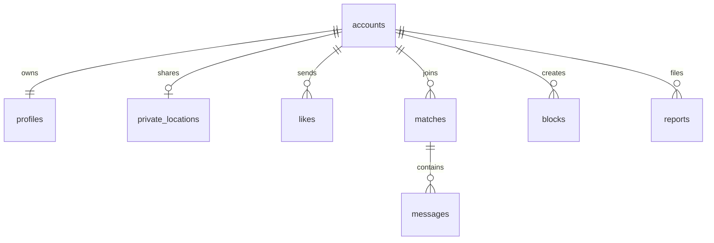

# MongoDB data model

The Go types live in `backend/models.go`. The current discovery API uses the public `Profile` projection in `backend/main.go`. Only profile reads are implemented today; the other collections and their indexes prepare the database for accounts and matching.

All relationship fields use a stable string account ID. Use a UUID or MongoDB ObjectID encoded as a string when account creation is implemented. Demo profiles use IDs such as `demo-sofia` and have no account owner. The database name defaults to `singlesfinder`.

| Collection | Main fields | Purpose |
| --- | --- | --- |
| `accounts` | `_id`, `email`, `passwordHash`, `birthDate`, `status`, timestamps | Private account and age gate. Normalize email before storing; hash passwords with a modern password hash. Never return this document in public API responses. |
| `profiles` | `id`, `accountId`, `name`, `age`, `role`, `bio`, `interests`, `looking`, `image`, `lat`, `lng`, timestamps | Public discovery data. `lat` and `lng` are approximate display points only. `accountId` identifies the owner and is excluded from the public response. Derive `age` from private birth date when creating or refreshing a profile. |
| `private_locations` | `accountId`, GeoJSON `point`, `sharingEnabled`, `updatedAt`, `expiresAt` | Opt-in precise location. Never return the point directly. Query it server-side and return coarse display coordinates or distance bands. |
| `likes` | `fromAccountId`, `toAccountId`, `createdAt` | One like per directed pair. A mutual pair can create a match. |
| `matches` | `accountIds`, `pairKey`, `createdAt`, `lastMessageAt` | One match per unordered pair. Sort IDs before creating `pairKey`; only matched users can message. |
| `messages` | `matchId`, `senderAccountId`, `body`, `createdAt`, `readAt` | Conversation messages. Verify the sender belongs to the match on every write and read. |
| `blocks` | `fromAccountId`, `toAccountId`, `createdAt` | Directed block. Apply before discovery, likes, matches, and messaging. |
| `reports` | `reporterAccountId`, `subjectAccountId`, `reason`, `details`, `status`, `createdAt` | Private moderation queue. Never expose reports through public profile endpoints. |

## Relationships

## Indexes created by the Go API

- `accounts.email`: unique.
- `profiles.id`: unique. `profiles.accountId`: unique and sparse, allowing ownerless demo records. `profiles.interests`: discovery filter.
- `private_locations.accountId`: unique. `private_locations.point`: `2dsphere` for future nearby queries. `private_locations.expiresAt`: TTL index with `expireAfterSeconds: 0`.
- `likes.fromAccountId + toAccountId`, `blocks.fromAccountId + toAccountId`, and `matches.pairKey`: unique, preventing duplicates.
- `messages.matchId + createdAt`, `matches.accountIds + lastMessageAt`, and `reports.status + createdAt`: common read paths.

MongoDB GeoJSON points use `[longitude, latitude]` order. For example, a private location point has `{"type":"Point","coordinates":[-106.08,28.63]}`. Set `expiresAt` to a future BSON date whenever sharing is enabled. TTL deletion is eventual, so discovery queries must also check `sharingEnabled` and `expiresAt > now`.

Before adding write endpoints, implement authentication, authorization, input validation, a minimum discovery radius, rate limits, and moderation. Keep the connection string and password hashes on the server. Do not expose `private_locations`, `accounts`, or reports through the discovery API.
