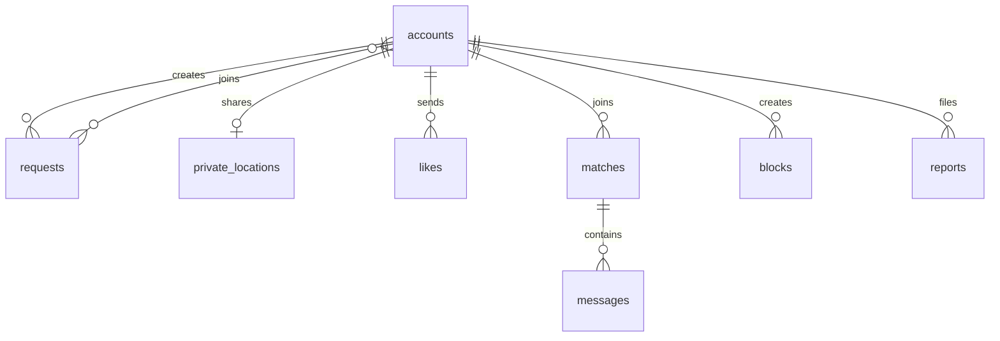

# MongoDB data model

The Go types live in `backend/models.go` and `backend/requests.go`. Account registration, login sessions, map requests, and personality-test preferences are persisted; messaging, matching, and moderation collections remain planned.

All relationship fields use a stable string account ID. Account IDs and request IDs are random 128-bit values encoded as hex strings. The database name defaults to `singlesfinder`.

| Collection | Main fields | Purpose |
| --- | --- | --- |
| `accounts` | `_id`, `name`, `email`, `passwordHash`, `birthDate`, `status`, `interests`, `personality`, `datePace`, `quizComplete`, timestamps | Private account and age gate. Email is normalized; passwords use bcrypt. The account document is never returned to clients; handlers return a safe projection. |
| `sessions` | `_id` (SHA-256 token hash), `accountId`, `expiresAt` | Server-side session; the raw random token is only sent in an `HttpOnly`, `SameSite=Lax` cookie. Expired records are removed by a TTL index. |
| `requests` | `_id`, `creatorId`, `creatorName`, `creatorInterests`, `description`, `lat`, `lng`, `participants`, `createdAt` | A real activity request created by an account. Coordinates are rounded to three decimal places before storage; owner and participant IDs are omitted from public responses. |
| `private_locations` | `accountId`, GeoJSON `point`, `sharingEnabled`, `updatedAt`, `expiresAt` | Opt-in precise location. Never return the point directly. Query it server-side and return coarse display coordinates or distance bands. |
| `likes` | `fromAccountId`, `toAccountId`, `createdAt` | One like per directed pair. A mutual pair can create a match. |
| `matches` | `accountIds`, `pairKey`, `createdAt`, `lastMessageAt` | One match per unordered pair. Sort IDs before creating `pairKey`; only matched users can message. |
| `messages` | `matchId`, `senderAccountId`, `body`, `createdAt`, `readAt` | Conversation messages. Verify the sender belongs to the match on every write and read. |
| `blocks` | `fromAccountId`, `toAccountId`, `createdAt` | Directed block. Apply before discovery, likes, matches, and messaging. |
| `reports` | `reporterAccountId`, `subjectAccountId`, `reason`, `details`, `status`, `createdAt` | Private moderation queue. Never expose reports through public profile endpoints. |

## Relationships

## Indexes created by the Go API

- `accounts.email`: unique.
- `sessions.expiresAt`: TTL index; `sessions.accountId`: account lookup.
- `requests.createdAt`: descending request feed. `requests.creatorId + createdAt`: creator request lookup.
- `private_locations.accountId`: unique. `private_locations.point`: `2dsphere` for future nearby queries. `private_locations.expiresAt`: TTL index with `expireAfterSeconds: 0`.
- `likes.fromAccountId + toAccountId`, `blocks.fromAccountId + toAccountId`, and `matches.pairKey`: unique, preventing duplicates.
- `messages.matchId + createdAt`, `matches.accountIds + lastMessageAt`, and `reports.status + createdAt`: common read paths.

MongoDB GeoJSON points use `[longitude, latitude]` order. For example, a private location point has `{"type":"Point","coordinates":[-106.08,28.63]}`. Set `expiresAt` to a future BSON date whenever sharing is enabled. TTL deletion is eventual, so discovery queries must also check `sharingEnabled` and `expiresAt > now`.

Browser geolocation is used locally only to center the map and is not written to MongoDB. Map request coordinates are user-selected, rounded to three decimals, and publicly visible to authenticated users. Before production, add rate limits, email verification, password recovery, moderation, and a minimum discovery radius. Keep the connection string and password hashes on the server. Do not expose `private_locations`, `accounts`, participant IDs, or reports through public APIs.
